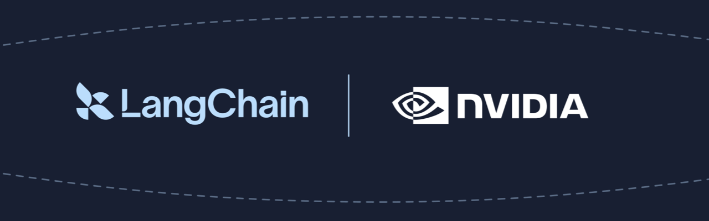

<p align="center">
  
</p>

# LangChain NVIDIA samples

## Overview

Build agents and RAG pipelines across the NVIDIA ecosystem with one LangChain code path. These samples wire chat, embedding, and reranking models into agents and chains with LangChain, orchestrate multi-step flows with LangGraph, and trace and evaluate runs with LangSmith, using `langchain-nvidia-ai-endpoints`. The same code reaches models hosted on the [NVIDIA API Catalog](https://build.nvidia.com) or self-hosted as [NIM](https://developer.nvidia.com/nim) microservices on your own GPUs, with NeMo Retriever for embedding and reranking.

## What's inside

| Example | What it shows | Stack |
|---|---|---|
| [nemotron-openshell-incident-agent](./examples/nemotron-openshell-incident-agent) | Deep Agent that analyzes incident logs by running Python in a policy-governed OpenShell sandbox, on NVIDIA Nemotron Ultra via NIM, traced in LangSmith | Deep Agents + langchain-nvidia-ai-endpoints + LangSmith |

## Quickstart

Clone the repo and change into an example:

```bash
git clone https://github.com/langchain-samples/langchain-nvidia-samples.git
cd langchain-nvidia-samples/examples/<example-name>
```

From there, follow that example's own README for setup, the NVIDIA and LangSmith keys or NIM endpoints it needs, and how to run it.

## License

This project is licensed under the [MIT License](LICENSE).
