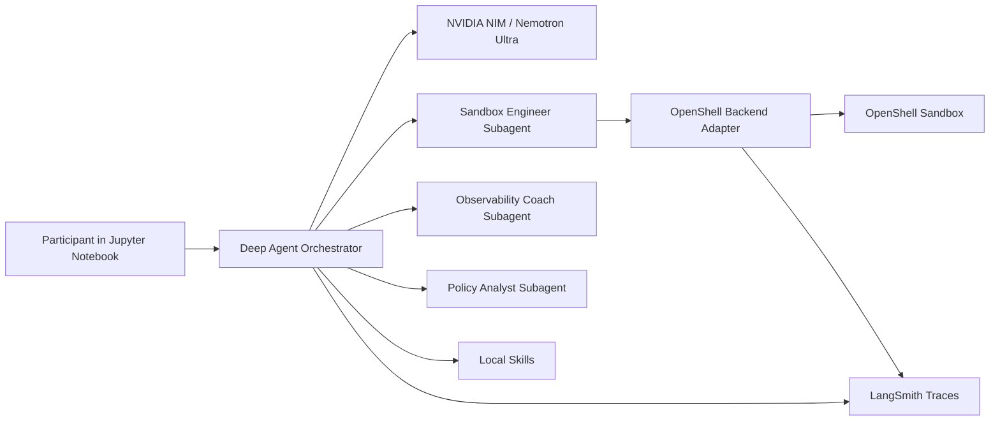

# NVIDIA OpenShell + Deep Agents + Nemotron Ultra Workshop

A notebook-first workshop for building and observing a Deep Agent powered by the recently announced NVIDIA Nemotron 3 Ultra 550B-A55B model through NVIDIA NIM. The agent analyzes application logs by writing and running Python inside an NVIDIA OpenShell sandbox, then sends trace data to LangSmith.

The main learning path is:

1. Run a Deep Agent from a Jupyter notebook.
2. Analyze a sample application log by writing and running Python in a policy-governed OpenShell sandbox.
3. Produce an incident summary JSON file and Markdown incident report.
4. Inspect the generated artifacts directly inside the OpenShell sandbox.
5. Inspect model calls, subagent delegation, filesystem operations, sandbox execution, generated artifacts, and policy denials in LangSmith.
6. See how NVIDIA NIM, Nemotron Ultra, OpenShell, Deep Agents, and LangSmith fit together.
7. Add skills and observability metadata so agent behavior is easier to debug.

## Contents

- `workshop/notebooks/participant_walkthrough.ipynb` - primary workshop.
- `src/openshell_obs_workshop/` - runnable Deep Agents app and OpenShell backend.
- `skills/` - small skills the notebook uses during the workshop.
- `workshop/data/sample_app.log` - sample incident log fixture.
- `workshop/policies/local-sandbox.yaml` - deterministic policy fixture for the allow/deny lab.
- `scripts/check_env.py` - local preflight that never prints secret values.
- `tests/` - lightweight sanity tests.

## Architecture



## Requirements

- Python 3.12+
- `uv`
- Docker Desktop running
- NVIDIA API key for Nemotron 3 Ultra 550B-A55B through NIM, or a self-hosted NIM endpoint
- LangSmith API key for tracing
- OpenShell CLI and a reachable OpenShell gateway

## Local OpenShell Implementation Requirements

This example contains the Deep Agents app and the OpenShell backend adapter. It does
not vendor or start the OpenShell gateway for you. A real OpenShell workshop has
three layers:

1. The Python app in this example.
2. The OpenShell CLI available to that process.
3. A reachable OpenShell gateway that can create Docker-backed sandboxes.

The preflight verifies all three. If Docker is running but `uv run openshell
status` says `No gateway configured`, OpenShell is not ready yet. That means the
agent would have no sandbox to execute in.

The supported participant path for this workshop is local OpenShell:

1. Configure `.env`.
2. Install dependencies with `uv sync --extra notebook`.
3. Install/start/register a local OpenShell gateway.
4. Run `uv run python scripts/check_env.py`.
5. Create `workshop-sandbox` with the workshop policy.
6. Run the notebook.

## Quickstart

```bash
cp .env.example .env
```

Edit `.env` and set `NVIDIA_API_KEY` and `LANGSMITH_API_KEY`. The default
model is `nvidia/nemotron-3-ultra-550b-a55b`, matching NVIDIA's recently
announced Nemotron 3 Ultra 550B-A55B model. If the hosted NIM listing is not
available in your account yet, use the exact model id shown on build.nvidia.com
or point `NVIDIA_BASE_URL` at a self-hosted Nemotron 3 Ultra NIM endpoint while
keeping `MODEL_PROVIDER=nvidia`.

Install dependencies and run the preflight:

```bash
uv sync --extra notebook
uv run python scripts/check_env.py
```

If preflight reports that the OpenShell gateway is not reachable, install/configure the OpenShell gateway first, then rerun preflight:

```bash
uv run openshell status
```

If `openshell status` says `No gateway configured`, Docker is running but OpenShell still has nowhere to create sandboxes. Follow the NVIDIA OpenShell installation docs or register and select an existing gateway before continuing.

Package-managed local gateway:

```bash
uv run openshell gateway add <endpoint> --name openshell
uv run openshell gateway select openshell
uv run python scripts/check_env.py
```

On macOS/Linux package installs, the local gateway endpoint is commonly
`https://127.0.0.1:17670`:

```bash
uv run openshell gateway add https://127.0.0.1:17670 --local --name openshell
uv run openshell gateway select openshell
uv run python scripts/check_env.py
```

If `gateway add` reports `Gateway 'openshell' already exists`, the gateway is
already registered. Skip the add step and continue with:

```bash
uv run openshell gateway select openshell
uv run python scripts/check_env.py
```

If `gateway add` reports `mTLS certificates for gateway 'openshell' were not
found`, the package-managed gateway has not started or has not provisioned its
client TLS bundle. Fix the gateway service before retrying:

```bash
which openshell
brew services restart openshell
openshell status
uv run openshell gateway add https://127.0.0.1:17670 --local --name openshell
uv run openshell gateway select openshell
uv run python scripts/check_env.py
```

If `which openshell` returns nothing, only the project-local Python package is
installed. Run the OpenShell installer first, or use the container gateway path
below.

Container gateway for local development:

```bash
docker run -d \
  --name openshell-gateway \
  --restart unless-stopped \
  -p 127.0.0.1:8080:8080 \
  -v openshell-state:/var/openshell \
  -v /var/run/docker.sock:/var/run/docker.sock \
  -e OPENSHELL_DRIVERS=docker \
  -e OPENSHELL_DB_URL=sqlite:/var/openshell/openshell.db \
  -e OPENSHELL_DISABLE_TLS=true \
  ghcr.io/nvidia/openshell/gateway@sha256:5e251baec790a61242a2190ea6fe26366d4dfe15ba1a7a0b612b5bef5af19aaa

uv run openshell gateway add http://127.0.0.1:8080 --local --name local
uv run openshell gateway select local
uv run python scripts/check_env.py
```

The container gateway example disables TLS and binds only to `127.0.0.1`, so it
is intended for a single local development machine, not a shared remote gateway.

Create the workshop sandbox non-interactively:

```bash
uv run openshell sandbox create --name workshop-sandbox --policy workshop/policies/local-sandbox.yaml --no-tty -- true
```

If the sandbox already exists, refresh the dynamic policy:

```bash
uv run openshell policy set workshop-sandbox --policy workshop/policies/local-sandbox.yaml --wait
```

Start the notebook:

```bash
uv run jupyter lab workshop/notebooks/participant_walkthrough.ipynb
```

## Workshop Flow

The notebook is the workshop. It walks through setup, preflight, sandbox creation, agent invocation, Python incident analysis, direct OpenShell artifact inspection, generated reports, policy observability, skill iteration, and LangSmith trace debugging. Each agent lab prints a clickable LangSmith trace link when tracing is configured.

## Agent Use Case

The agent is a sandboxed incident-analysis assistant. The sample data in `workshop/data/sample_app.log` is a synthetic application log from a small ecommerce-style system with frontend, auth, inventory, checkout, and payments services. It contains normal requests, latency warnings, repeated inventory database timeouts, checkout failures, status codes, request IDs, timestamps, service names, paths, and latency values.

The agent should copy that log into OpenShell, write and run a Python parser in the sandbox, compute concrete evidence about errors and latency, identify the likely failure pattern, write `/sandbox/incident_summary.json` and `/sandbox/incident_report.md`, and explain how to inspect the run in LangSmith.
