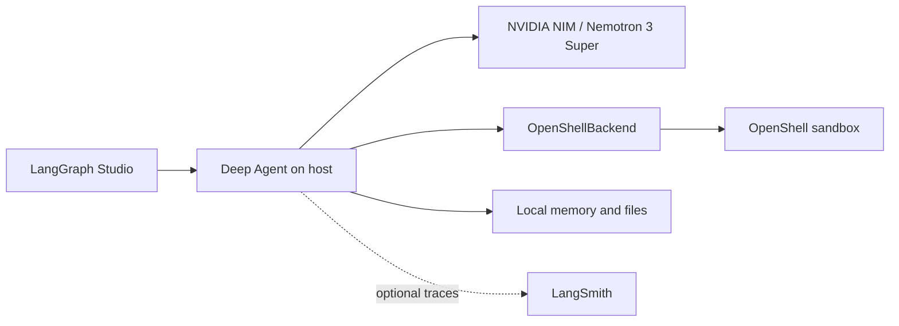

# OpenShell Deep Agent

A general-purpose coding agent powered by **NVIDIA Nemotron 3 Super** and
[Deep Agents](https://docs.langchain.com/oss/python/deepagents/overview), with
code execution in an [NVIDIA OpenShell](https://github.com/NVIDIA/OpenShell)
sandbox. Use LangGraph Studio to ask it to write scripts, analyze data, and
read back results from a policy-governed Linux environment.

Imported from [langchain-ai/openshell-deepagent](https://github.com/langchain-ai/openshell-deepagent)
at commit [`89de324`](https://github.com/langchain-ai/openshell-deepagent/tree/89de32444ff0e2746d42d92bdae38f4002fcb3b2).
The environment template, sandbox policy, and dependency lockfile are preserved.
This copy separates writable memory from application source and adapts the setup
for the samples repository.

## Architecture

The agent runtime and model client run on your host in the LangGraph development
server. The `OpenShellBackend` sends shell commands and file operations to a
separate OpenShell sandbox. NVIDIA-hosted inference requires network access and
an API key; sandbox execution runs on your local Docker-backed gateway.



- Sandbox file tools and `execute` use `BaseSandbox` and `SandboxSession.exec()`.
  Write scripts and results under `/sandbox/`.
- `/memory/` maps to the example's dedicated `memory/` directory;
  `/memory/AGENTS.md` provides persistent instructions. This keeps agent memory
  writes separate from the Python source in `src/`. `/skills/` maps to the
  example's `skills/` directory, but this example does not ship skills or enable
  automatic skill loading. Both local paths resolve relative to the example,
  independently of the current working directory.
- OpenShell enforces the sandbox's configured filesystem, process, and network
  policies. Host-side model calls and local memory are outside that boundary.

For guided incident-analysis labs, see
[`nemotron-openshell-incident-agent`](../nemotron-openshell-incident-agent).
For the agent runtime itself running inside OpenShell, see
[`nemotron-openshell-contained-incident-agent`](../nemotron-openshell-contained-incident-agent).

## Requirements

- Python 3.12+ and [uv](https://docs.astral.sh/uv/getting-started/installation/).
- Docker Desktop or another working Docker runtime.
- An NVIDIA API key with access to `nvidia/nemotron-3-super-120b-a12b` from
  [build.nvidia.com](https://build.nvidia.com).
- Optionally, a LangSmith API key for tracing.

The included `uv.lock` preserves the upstream environment, including
`openshell==0.0.7` and `deepagents==0.4.11`. The commands below use that
project-local OpenShell CLI. The other examples have their own environments and
OpenShell versions.

## Quickstart

### 1. Clone and enter this example

```bash
git clone https://github.com/langchain-samples/langchain-nvidia-samples.git
cd langchain-nvidia-samples/examples/openshell-deepagent
uv sync --locked
uv run openshell --version
```

Run the remaining commands from this directory so the CLI finds `langgraph.json`
and `.env`.

### 2. Configure the environment

```bash
cp .env.example .env
```

Set `NVIDIA_API_KEY` in `.env`. Keep
`OPENSHELL_SANDBOX_NAME=deepagent-sandbox` to reuse the sandbox created below.
To enable tracing, set `LANGSMITH_API_KEY`, `LANGSMITH_TRACING=true`, and
`LANGSMITH_PROJECT=openshell-deep-agent`.

`langgraph.json` loads `.env` when the development server starts. The model is
configured in `src/agent.py` as `nvidia/nemotron-3-super-120b-a12b` with
temperature `0.1` and a maximum output of `16384` tokens.

### 3. Start the gateway and create a sandbox

Make sure Docker is running, then start the gateway:

```bash
uv run openshell gateway start
uv run openshell status
```

Create a persistent sandbox using the included policy:

```bash
uv run openshell sandbox create \
  --name deepagent-sandbox \
  --policy policy.yaml \
  --no-tty -- true
```

OpenShell 0.0.7 keeps sandboxes by default; `true` exits the initial command and
returns to your terminal. If the named sandbox already exists, reuse it after
checking its active policy, or choose another name and update `.env` to match.
Without `OPENSHELL_SANDBOX_NAME`, the backend creates a sandbox with OpenShell's
default policy; pre-creating one is the path for applying `policy.yaml`.

### 4. Start the agent

```bash
uv run langgraph dev --allow-blocking
```

Open the Studio URL printed by the server, select the `deepagent` graph, and
send a message. The default local API address is
[`http://127.0.0.1:2024`](http://127.0.0.1:2024). The `--allow-blocking` flag
allows the backend's synchronous OpenShell calls during local development.

## Try it

**Check the environment:**

```text
Run uname -a and python3 --version in the sandbox and summarize the results.
```

**Write and read a file:**

```text
Write /sandbox/hello.txt containing "hello from OpenShell", then read it back.
```

**Analyze data:**

```text
Write and run a Python script that generates 500 random numbers, computes
the mean, median, standard deviation, minimum, and maximum, and saves the
summary to /sandbox/results.txt. Read the file back and explain the results.
```

## Inspect and update policies

The bundled `policy.yaml` contains filesystem permissions and network rules for
specific destinations and executables. Review it for your use case. A request's
result depends on the sandbox's active policy and the binary making the request.

```bash
uv run openshell policy get deepagent-sandbox --full

# After editing policy.yaml, apply supported live policy changes:
uv run openshell policy set deepagent-sandbox --policy policy.yaml --wait
```

For changes that require sandbox recreation, delete and recreate the sandbox
with `--policy policy.yaml` after saving any files you need.

## Inspect and clean up

```bash
uv run openshell status
uv run openshell sandbox list
uv run openshell logs deepagent-sandbox --tail --source sandbox

# After saving any sandbox outputs you want to keep:
uv run openshell sandbox delete deepagent-sandbox
uv run openshell gateway stop
```

## Troubleshooting

| Problem | Fix |
|---|---|
| `No module named 'openshell'` | Run `uv sync --locked` inside this example. |
| `no active gateway configured` | Start the gateway with `uv run openshell gateway start`, then check `uv run openshell status`. |
| Gateway won't start | Confirm Docker is running with `docker info`. |
| CLI flags differ from this README | Use `uv run openshell` from this example's locked environment. |
| Named sandbox not found | Create it on the selected gateway and match `OPENSHELL_SANDBOX_NAME` in `.env`. |
| NVIDIA authentication or model access fails | Check `NVIDIA_API_KEY` and access to the configured model in the NVIDIA API Catalog. |
| Memory files are missing | Confirm `memory/AGENTS.md` exists beside `src/` in this example. |
| Sandbox write fails | Use `/sandbox/` and inspect the active filesystem policy. |

## Local regression tests

After installing the locked environment, run:

```bash
uv run python -m unittest discover -s tests -v
```

These tests use temporary directories and a mocked OpenShell connection to check
memory persistence, separation from source files, path confinement, and operation
from a different working directory. They require no API keys or running gateway.

## Resources

- [Original OpenShell Deep Agent](https://github.com/langchain-ai/openshell-deepagent)
- [NVIDIA OpenShell](https://github.com/NVIDIA/OpenShell)
- [Deep Agents documentation](https://docs.langchain.com/oss/python/deepagents/overview)
- [The two patterns for agent sandboxes](https://blog.langchain.com/the-two-patterns-by-which-agents-connect-sandboxes/)
